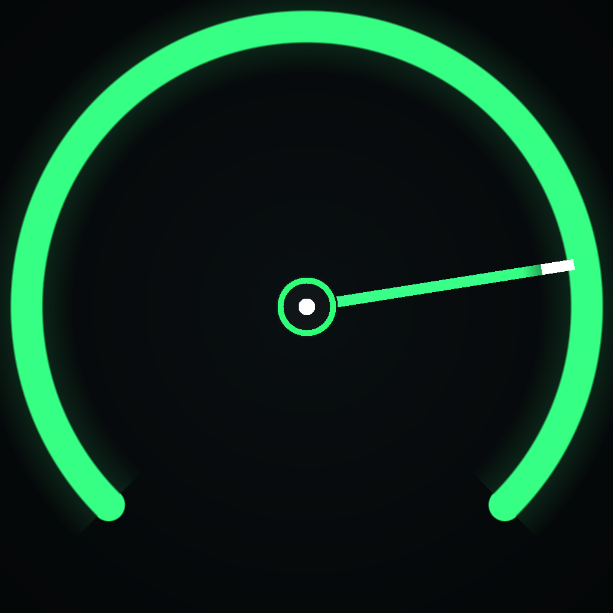

# SpeedX

Dark, neon-green SwiftUI speedometer for iOS. Real app, real Core Location, no web views.



## What works

- Big analogue-style dial (0–90 km/h) with animated needle, arc, ticks, digital readout
- Max speed, average speed, distance, trip timer tiles — all updating live
- Start / Pause / Resume / Reset controls with haptics
- GPS accuracy badge; distance is scaled by a course-cast confidence model so GPS
  jitter cannot inflate the odometer
- Optional **simulated drive** (`AppConfig.simulatedDrive`, enabled by default) so
  the app can be exercised indoors / on the iOS Simulator without satellite lock

## Project layout

```
SpeedX/
├── SpeedX.xcodeproj/          # Xcode project (sources + tests target wired)
├── SpeedX/                    # app sources
│   ├── ContentView.swift        main screen: gauge, tiles, controls, live overlay
│   ├── MotionSimulator.swift    scripted indoor drive for testing (off via AppConfig)
│   ├── SpeedometerGauge.swift   the dial itself
│   ├── SpeedXApp.swift          @main + window + Time Trial hooks
│   ├── StatTile.swift           stats cards
│   ├── Theme.swift              palette, gradients, haptics, AppConfig
│   ├── TripEngine.swift         Core Location engine (start/pause/reset states)
│   └── Info.plist
├── Resources/Assets.xcassets  # app icon (dark neon speedometer motif)
├── scripts/
│   ├── make_icon.py           regenerates the icon (pure Python, zero deps)
│   ├── check_source.py        static audit of sources/project wiring
│   └── verify_ipa.py          validates a built .ipa (Windows-friendly)
├── build_ipa.sh               one-command .ipa build for macOS/CI
└── .github/workflows/         builds the .ipa on macOS runners on push
```

## Building & running

### Everyday development (Mac + iPhone)

1. Open `SpeedX.xcodeproj` in Xcode 15+ on a Mac.
2. Select the **SpeedX** target → **Signing & Capabilities** → tick *Automatically
   manage signing* and choose your team (free Apple ID works).
3. Plug in the iPhone, select it as the run destination, **Run**.
4. On first launch the device asks for location permission — allow it while
   using the app, then step outside for a first GPS fix.

Before shipping, switch OFF the indoor test rig: in `SpeedX/Theme.swift`
set `AppConfig.simulatedDrive = false` so the dial runs on real GPS.

### Building the .ipa (macOS or CI)

```bash
./build_ipa.sh          # -> build/SpeedX-unsigned.ipa
```

The result is compiled, but **unsigned** (no Apple Developer Program needed to
build). Sign it on your PC with [Sideloadly](https://sideloadly.io) or
[AltStore](https://altstore.io): drag the .ipa in, sign with your Apple ID,
install. On iOS 16+ the phone needs **Developer Mode** enabled first.

### Or let GitHub build it for you (recommended when you have no Mac)

The repo ships `.github/workflows/build_ipa.yml`:

```bash
git init
git add -A
git commit -m "SpeedX v1.0"
git remote add origin https://github.com/<you>/speedx.git
git push -u origin main   # then check the Actions tab
```

Every push triggers a macOS runner that runs `build_ipa.sh` and uploads
`SpeedX-ipa.zip` (containing the .ipa) as an artifact. Download, verify
locally with `python scripts/verify_ipa.py`, sign, install.

## Checking your work on Windows

```bash
python scripts/check_source.py            # structural audit, all-green required
python scripts/verify_ipa.py build/SpeedX-unsigned.ipa
```

`verify_ipa.py` unpacks the zip, inspects Mach-O headers, validates embedded
Info.plist contents (name, permissions, background modes) and tells you whether
the build carries a provisioning profile.

## Troubleshooter's checklist

| Symptom | Fix |
| --- | --- |
| `errSSAcrossDevice` / signing failure | Revoke certificate in Xcode: Settings → Accounts → click team → *Download Manual Profiles* / revoke; then rebuild |
| Dial stuck at 0 with real GPS | Set `AppConfig.simulatedDrive = false`, ensure permission granted while active, go outdoors |
| Install blocked on device | Enable Settings → Privacy & Security → **Developer Mode** |
| Distance looks tiny on a drive | Accurate GPS needs a few metres of movement; the course-cast filter ignores jitter on purpose |
